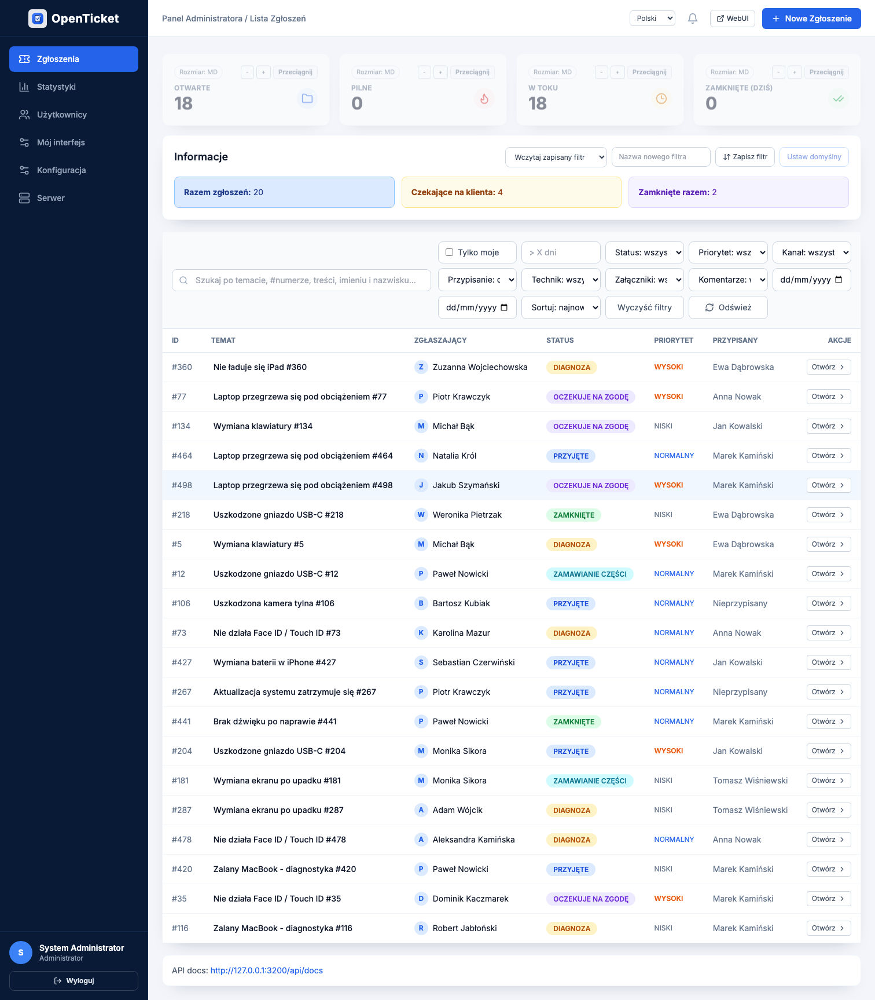

# OpenTicket

### Zgłoszenia serwisowe od przyjęcia urządzenia do zakończenia naprawy

System dla małych i średnich serwisów elektroniki: klienci, urządzenia, etapy naprawy, komentarze i koszty w jednym miejscu. Interfejs webowy oraz aplikacja desktopowa.

[Wydania i instalatory](https://github.com/damianx9x/OpenTicket/releases) · [Galeria interfejsu](docs/UI_SHOWCASE_PL.md) · [Rozwój](DEVELOPMENT.md) · [Zgłoś problem](https://github.com/damianx9x/OpenTicket/issues) · [English](README.en.md)

## Co obejmuje projekt

| Obszar | Zakres |
| :--- | :--- |
| Przyjęcie zgłoszenia | Klient, urządzenie, opis problemu i zdjęcia |
| Praca serwisu | Statusy, komentarze, koszty i historia |
| Panel operatora | Filtry, ustawienia widoku i motywy |
| Administracja | Role, konfiguracja, diagnostyka i kopie zapasowe |
| Tryby pracy | Serwer z klientem, sam klient lub host zdalny |

## Stan projektu

- **Gałąź domyślna:** `develop`; wersja w pakietach: `0.5.2-pre-alpha`.
- **Ostatnie stabilne wydanie widoczne w GitHub Releases:** `v0.4.1` (stan odczytany 26.10.2026).
- Kod rozwojowy i opublikowany instalator mogą reprezentować różne etapy produktu. To projekt na etapie pre-alpha; przed użyciem z rzeczywistymi danymi sprawdź wybrany build i procedurę odzyskiwania.

<!-- INSTALLER_LINK:START -->
## Pobierz instalator

- [macOS — PKG](https://github.com/damianx9x/OpenTicket/releases/latest/download/OpenTicket-Installer.pkg)
- [Windows — EXE](https://github.com/damianx9x/OpenTicket/releases/latest/download/OpenTicket-Installer.exe)
- [Wszystkie wydania, warianty i sumy kontrolne](https://github.com/damianx9x/OpenTicket/releases)
<!-- INSTALLER_LINK:END -->

## Zacznij tutaj

- **Chcesz poznać produkt?** Zobacz [katalog interfejsu](docs/UI_SHOWCASE_PL.md).
- **Chcesz uruchomić kod?** Przejdź do [instrukcji deweloperskiej](DEVELOPMENT.md).
- **Potrzebujesz hosta zdalnego?** Zobacz [szybki start](docs/REMOTE_INSTALL_QUICKSTART_PL.md), [Linux](docs/REMOTE_INSTALL_LINUX.md) lub [Synology](docs/REMOTE_INSTALL_SYNOLOGY.md).
- **Chcesz pomóc?** Przeczytaj [zasady współpracy](CONTRIBUTING.md).

## Technologia i struktura

| Katalog | Technologia / odpowiedzialność |
| :--- | :--- |
| [backend/](backend/) | NestJS, TypeScript, Prisma, SQLite runtime |
| [frontend/](frontend/) | Next.js, React, TypeScript |
| [desktop/](desktop/) | Electron, electron-builder |
| [ios/](ios/) | Osobny moduł iOS; [plan rozwoju](docs/IOS_DEVELOPMENT_PLAN.md) |
| [deploy/](deploy/) | Skrypty instalacji hosta |
| [docs/](docs/) | Interfejs, instrukcje i raporty |

## Jakość i dokumentacja

Repozytorium zawiera scenariusze smoke, kontrolę uprawnień, testy interfejsu i raporty historyczne. Ich obecność nie potwierdza aktualnego przejścia testów na każdym urządzeniu. `make test` wykonuje kompilację trzech modułów; scenariusze runtime uruchamia się oddzielnie zgodnie z [DEVELOPMENT.md](DEVELOPMENT.md).

[Historia zmian](CHANGELOG.md) · [Budowanie](BUILD.md) · [Plan testów bezpieczeństwa](docs/SECURITY_TEST_PLAN.md)

## Licencja

Kod jest publicznie dostępny. W tej gałęzi nie ma obecnie pliku LICENSE; wybór licencji open source pozostaje do zatwierdzenia przez autora.

---

Projekt: [Damian Eron](https://github.com/damianx9x) · [Portfolio](https://github.com/damianx9x/damianx9x)
